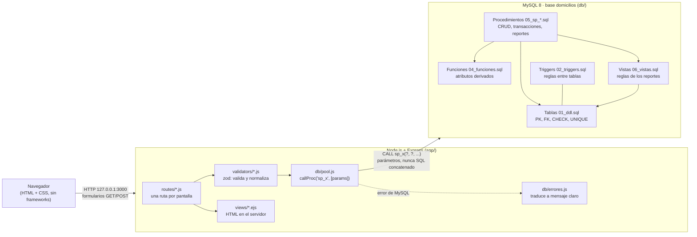
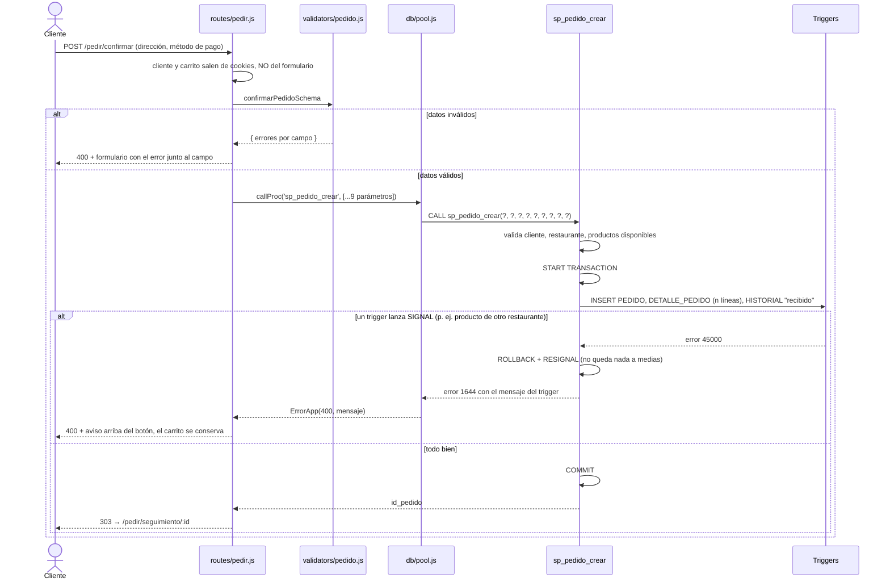

# Arquitectura · Domicilios (Caso 7)

Cómo está armada la aplicación de punta a punta, qué valida cada capa y por qué, cómo se manejan los errores y qué medidas de seguridad tiene (y cuáles no).

## 1. Vista general



| Capa | Archivos | Responsabilidad |
|---|---|---|
| Presentación | `app/views/**/*.ejs`, `app/public/css/` | Pintar datos y formularios. No calcula nada del negocio. |
| Rutas | `app/routes/*.js` | Leer la petición, validar, llamar **un** procedimiento por acción, decidir qué vista mostrar. |
| Validación | `app/validators/*.js` (zod) | Rechazar datos mal formados antes de ir a MySQL, con un mensaje por campo. |
| Acceso a datos | `app/db/pool.js` | Única puerta a MySQL: `callProc()`. La app **no tiene ni un `SELECT` suelto**. |
| Reglas de negocio | `db/02_triggers.sql`, `db/05_sp_*.sql` | Viven en la base. Se cumplen aunque alguien se salte la app. |
| Análisis | `db/06_vistas.sql`, `db/05_sp_reportes.sql`, `db/07_consultas.sql` | Vistas con las reglas de los reportes; procedimientos que las leen; banco de consultas. |

## 2. Recorrido de una petición: confirmar un pedido



## 3. Qué valida la app y qué valida la base, y por qué las dos

Se valida **dos veces a propósito**. No es redundancia: cada capa cubre algo que la otra no puede.

| Regla | App (zod) | Base de datos | Por qué ahí |
|---|---|---|---|
| Campos obligatorios, largos máximos, formato de correo, teléfono y fecha | ✔ | `NOT NULL`, tamaño de columna | La app da el mensaje junto al campo y en español antes de gastar un viaje a MySQL. |
| Cliente de al menos 14 años | ✔ | — | Regla de formulario. |
| Correo, NIT, documento y placa únicos | — | `UNIQUE` | Solo la base sabe qué hay guardado, y lo garantiza aunque lleguen dos peticiones a la vez. |
| Precio > 0, notas 1 a 5, método de pago válido, placa según vehículo | ✔ (parcial) | `CHECK` | La base es la última defensa: aplica aunque se inserte por fuera de la app. |
| Productos del pedido del mismo restaurante | El carrito lo impide | Trigger `trg_detalle_bi` | Compara dos tablas: un `CHECK` no puede. El trigger no se puede saltar. |
| Flujo de estados (sin saltos ni retrocesos, cancelar solo desde recibido o preparación) | Solo ofrece el botón válido | Trigger `trg_historial_bi` | La interfaz guía; la base impide. Probado con `POST` manipulado en `tests/pedidos.test.js`. |
| "En camino" exige repartidor; calificar solo pedidos entregados | — | Triggers | Reglas entre tablas. |
| Pedido completo o nada | — | Transacción en `sp_pedido_crear` | Solo la base puede deshacer varias escrituras como una unidad. |
| Filtros de reportes en rango | ✔ `validators/reporte.js` | `SIGNAL` en `sp_reporte_*` | Los filtros llegan por la URL y se pueden editar a mano. |

## 4. Manejo de errores

Todo error de MySQL pasa por `app/db/errores.js`, que lo convierte en un `ErrorApp` con mensaje para la persona, código HTTP y, si aplica, el campo culpable:

| Origen en MySQL | errno / SQLSTATE | Respuesta |
|---|---|---|
| `SIGNAL` de regla de negocio (procedimiento o trigger) | 1644 / `45000` | 400 con el mensaje exacto del `SIGNAL` |
| `SIGNAL` de "no existe" (convención del proyecto) | 1644 / `45004` | 404 |
| Violación de `UNIQUE` / `CHECK` | 1062 / 3819 | 409 / 400 con mensaje según el nombre de la restricción |
| Llave foránea | 1451 / 1452 | 409 / 400 |
| MySQL apagado, credenciales malas, base sin crear | `ECONNREFUSED`, 1045, 1049 | 503 con la instrucción para arreglarlo |
| Cualquier otro | — | 500 con mensaje honesto y detalle técnico en pequeño |

En la pantalla el mensaje sale en un aviso en línea (`partials/aviso.ejs`, `role="alert"`) junto al formulario, con el código técnico (`MySQL 1644 45000 · SIGNAL`) debajo para depurar.

**Transacciones.** Los procedimientos que escriben en varias tablas (`sp_cliente_crear`, `sp_pedido_crear`, `sp_pedido_avanzar_estado`) declaran `DECLARE EXIT HANDLER FOR SQLEXCEPTION BEGIN ROLLBACK; RESIGNAL; END`: ante cualquier error deshacen todo y reenvían el error **original**, así el mensaje claro del trigger llega intacto a la app. `db/08_transacciones.sql` lo demuestra a mano y `tests/` lo verifica automáticamente.

## 5. Seguridad

| Medida | Dónde | Qué evita |
|---|---|---|
| Solo `CALL` con parámetros `?` | `app/db/pool.js` | Inyección SQL: mysql2 escapa cada valor; nunca se concatena texto del usuario en SQL. |
| Nombre del procedimiento en lista blanca (`/^sp_[a-z0-9_]+$/`) | `app/db/pool.js` | El nombre no puede ir como `?`, así que se valida antes. |
| `multipleStatements: false` | `app/db/pool.js` | Que un valor tipo `x; DROP TABLE ...` ejecute una segunda instrucción. |
| **Usuario MySQL con solo `EXECUTE`** | `db/10_usuario_app.sql` | Si se filtran las credenciales del `.env`, ese usuario no puede `SELECT`, `DELETE` ni `DROP`: solo llamar procedimientos. Funciona porque los procedimientos son `SQL SECURITY DEFINER`. Probado: la app completa funciona con ese usuario y `SELECT * FROM CLIENTE` da `ERROR 1142`. Es opcional (ver el archivo); con `root` también funciona. |
| Credenciales en `.env`, ignorado por Git | `.gitignore`, `.env.example` | Contraseñas en el repositorio. |
| Escucha solo en `127.0.0.1` | `app/config.js` | Que otro equipo de la red abra la app. |
| Cabeceras seguras (`helmet`), formularios con tamaño máximo (50 kb) | `app/app.js` | Clickjacking, sniffing de tipos, cuerpos gigantes. |
| Cliente y restaurante del pedido salen de cookies `httpOnly` y se revalidan | `app/routes/pedir.js` | Falsear el pedido desde el HTML: los productos del carrito se vuelven a buscar en la base y el trigger rechaza mezclas. |

**Limitaciones conocidas (dichas de frente):**
- **No hay inicio de sesión real.** "¿Quién pide?" simula uno eligiendo un cliente. Por eso `/pedir/seguimiento/:id` no comprueba que el pedido sea del cliente elegido: cambiando el número en la URL se ve (y se puede calificar) el pedido de otro. En un sistema real se resolvería con sesiones y un `WHERE id_cliente = ?` en el procedimiento.
- Las cookies del carrito no están firmadas: se pueden editar en el navegador. No es grave porque el servidor y la base revalidan productos y restaurante, pero sí se puede poner cualquier cantidad positiva (el tope de 20 solo lo aplica el botón **+**).
- `npm run db:setup` y `npm test` necesitan un usuario con permiso de crear bases (normalmente `root`); solo la app en ejecución puede usar el usuario restringido.

## 6. Reportes: vistas, procedimientos y rendimiento

```
06_vistas.sql                           05_sp_reportes.sql              app/routes/reportes.js
vw_pedido_resumen ──┬─ vw_ventas_restaurante ── sp_reporte_restaurantes ──┐
(1 fila por pedido) ├─ vw_desempeno_repartidor ─ sp_reporte_repartidores ─┤
                    ├─ vw_tiempo_entrega_zona ── sp_reporte_tiempos_entrega┼─► GET /reportes
                    ├─ vw_ventas_mensuales ───── sp_reporte_ventas_mensuales┤
                    └──────────────────────────── sp_reporte_resumen ───────┘
                    vw_producto_ventas (usada en 07_consultas.sql)
```

- **Las reglas del negocio viven en las vistas y se escriben una sola vez:** venta = pedido **entregado**; ventas del restaurante **sin** costo de envío (el envío es de la plataforma); tiempo de entrega = minutos de "recibido" a "entregado".
- **Los procedimientos no recalculan:** filtran, ordenan, numeran el puesto con `RANK()` y limitan filas. Validan sus parámetros con `SIGNAL`.
- **Ranking de repartidores con mínimo de calificaciones:** con los datos de prueba, varios repartidores tienen 5,0 con 1 sola nota. Sin el mínimo, el "mejor repartidor" sería el que menos ha trabajado.

**Decisión de rendimiento (medida, no supuesta).** La primera versión de `vw_pedido_resumen` llamaba `fn_total_pedido`, `fn_estado_actual` y `fn_tiempo_entrega` por cada pedido. Con la carga de rendimiento (`npm run db:perf`, 5.250 pedidos):

| Versión de `vw_pedido_resumen` | Cada reporte | Página `/reportes` completa |
|---|---|---|
| Funciones fila por fila | 0,8 a 1,7 s | ~6 s |
| JOIN sobre tablas agrupadas (versión final) | 0,06 a 0,1 s | ~0,35 s |

Cada llamada a una función ejecuta sus propios `SELECT`: miles de consultas pequeñas. Con `JOIN` MySQL recorre cada tabla una vez. Las funciones siguen siendo la **definición oficial** para un solo pedido (panel de pedidos, seguimiento), y la prueba *"vw_pedido_resumen calcula total, estado y tiempo IGUAL que las funciones de P3"* compara las dos para **todos** los pedidos: si alguien cambia una y no la otra, `npm test` falla.

**Detalle técnico (collation).** Comparar el texto que devuelve `fn_estado_actual()` con un literal (`= 'entregado'`) dentro de un objeto creado desde Node falla con *Illegal mix of collations*: la conexión de `mysql2` usa `utf8mb4_general_ci` y la base `utf8mb4_0900_ai_ci`. Por eso las vistas filtran por `id_estado_actual` (4 = entregado, 5 = cancelado), que además es más rápido.

## 7. Pruebas automatizadas

`npm test` crea la base aparte `domicilios_test` con los mismos scripts de `00_run_all.sql` y corre 20 pruebas:

| Archivo | Qué cubre |
|---|---|
| `tests/clientes.test.js` (P1) | Validación, creación con teléfonos, mensaje de `SIGNAL`, 404, ROLLBACK de `sp_cliente_crear`. |
| `tests/pedidos.test.js` (P4) | Validación de pedido y filtros · pedido válido por el flujo Pedir completo (HTTP) · producto de otro restaurante con mensaje claro · **ROLLBACK a mitad de `sp_pedido_crear` deja PEDIDO, DETALLE e HISTORIAL sin cambios** · transición inválida desde el panel · "en camino" sin repartidor · flujo completo hasta calificar · vista = funciones · reportes cuadran entre sí · mínimo de calificaciones · pantalla `/reportes` · las 39 consultas de `07_consultas.sql` corren y dejan los datos intactos. |

Las pruebas no dependen de números fijos de los datos semilla: cada una mide su "antes" y su "después". Se comprobó que **sí detectan fallas** (prueba de mutación): al quitar el `ROLLBACK` de `sp_pedido_crear` fallan 2 pruebas; al dañar la fórmula del subtotal en la vista falla la de equivalencia.

## 8. Orden de los scripts SQL

| Archivo | Lo corre `db:setup` | Contenido |
|---|---|---|
| `01_ddl.sql` | ✔ | 12 tablas, PK, FK, `CHECK`, `UNIQUE`, `DEFAULT`, catálogo `ESTADO` |
| `02_triggers.sql` | ✔ | Reglas entre tablas con `SIGNAL` |
| `03_seed_clientes.sql`, `03_seed.sql` | ✔ | Datos de prueba realistas |
| `04_funciones.sql` | ✔ | Atributos derivados (`fn_edad`, `fn_total_pedido`, `fn_estado_actual`, `fn_tiempo_entrega`) |
| `05_sp_clientes.sql`, `05_sp_catalogo.sql`, `05_sp_pedidos.sql` | ✔ | Procedimientos por módulo |
| `06_vistas.sql` | ✔ | Vistas de análisis |
| `05_sp_reportes.sql` | ✔ | Reportes (después de las vistas porque las leen) |
| `09_indices.sql` | ✔ | Índices; evidencia en `docs/indices.md` |
| `07_consultas.sql` | — | Banco de 39 consultas (13 temas × 3), se corre a mano |
| `08_transacciones.sql` | — | Demostración manual de COMMIT y ROLLBACK |
| `10_usuario_app.sql` | — | Usuario con solo `EXECUTE` (opcional, requiere root) |
| `perf/generar_5000.sql` | `npm run db:perf` | Carga de rendimiento |
